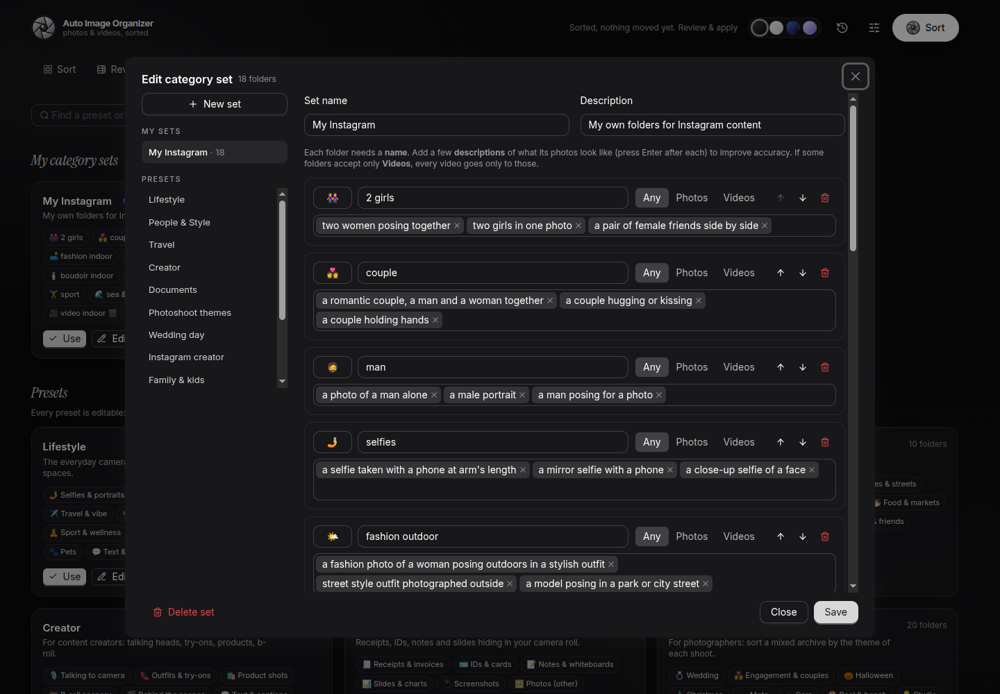
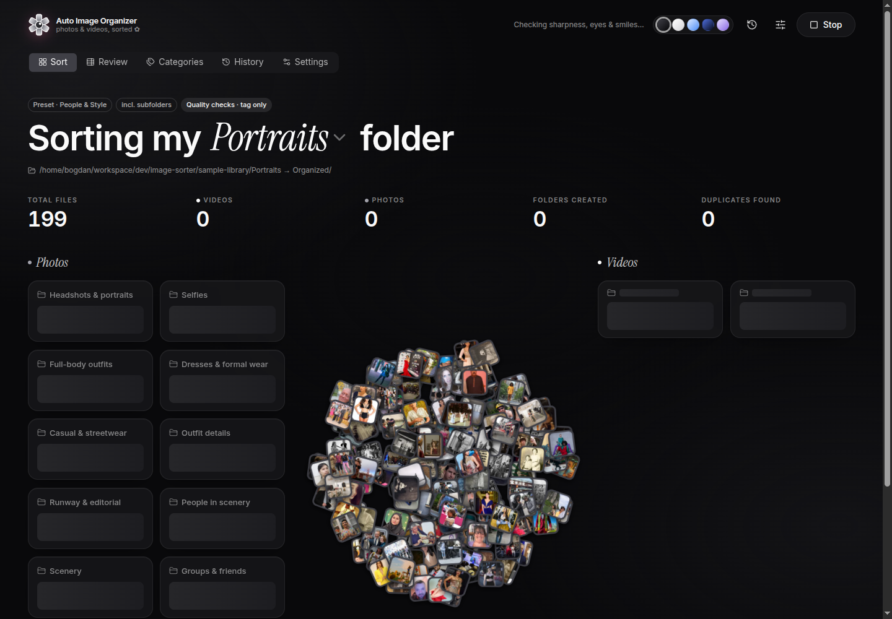
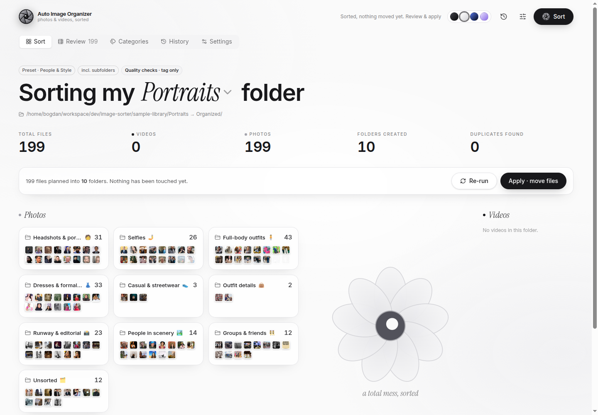

<div align="center">


# Auto Image Organizer

**Turn a messy photo folder into beautifully organized albums. Locally, in seconds, with an undo button.**

Sort by what's *in* the photos, cull a shoot like a pro (blurry · eyes closed · best of burst),
and watch every thumbnail fly into its folder.

[](LICENSE)
[](#-quick-start)
[](backend)
[](backend)
[](frontend)
[](frontend)
[](#-ai-is-optional)
[](CONTRIBUTING.md)
[](https://github.com/bogdancstrike/image-organizer/stargazers)

[Quick start](#-quick-start) · [Features](#-features) · [Screenshots](#-screenshots) · [For photographers](#-for-photographers-culling) · [Performance](#-performance--hardware) · [Deploy](#-deployment) · [Docs](#-documentation)

<br/>


</div>

---

## ✨ Why

Your *Downloads*, your phone dump, last weekend's shoot: thousands of files called `IMG_4821.JPG`.
**Auto Image Organizer** looks at every photo and video, understands what it shows, and proposes a clean folder
structure. Nothing moves until you press **Apply**, and every apply can be **undone**.

- 🧠 **Understands content.** CLIP sorts *outfits*, *mountains*, *studio light*, *food & cafés*, *screenshots* … no tags needed.
- 📸 **Built for photographers.** Culling with blur, eyes-closed and exposure checks, best-of-burst, stars, and RAW + JPEG pairs.
- 🔒 **Private by default.** Everything runs on your machine. AI is an optional, token-frugal helper.
- ↩️ **Safe.** You get a plan, then Apply, and a journal records every move, so Undo restores every file.
- 🎞️ **Delightful.** A pile of polaroids flies into folder cards. Four themes: **Graphite** (default), Light, Midnight, Lavender.

## 🚀 Quick start

```bash
git clone https://github.com/bogdancstrike/image-organizer.git && cd image-organizer
cp .env.example .env            # optional: OPENAI_API_KEY, LIBRARY_PATH …
docker compose up -d --build    # first build bundles the models (~3 min)
```

Open **http://localhost:8080**, click the folder name in *"Sorting my **…** folder"*, pick a folder, and press **Sort**.

> 💡 No photos at hand? `./scripts/download-samples.sh` (landscapes, duplicates, clips) and
> `python3 scripts/download-portraits.py` (200 openly licensed portraits & outfits) fill `./sample-library/`.

## 🧩 Features

### Organize any way you like

| Mode | What you get | Good for |
|---|---|---|
| **Preset** | 13 ready-made, **editable** folder sets | Instant results |
| **My categories** | Your own folders, each described in a few words (and *Photos-only / Videos-only*) | Your Instagram system, client workflows |
| **Auto-discover** | Groups found automatically, named by **what makes them different** inside your folder | Unknown dumps, a studio shoot, a wedding |
| **By date** | `2025/07 - July` from EXIF / video metadata | Archives |
| **Cull** | Keepers · Smiling · Maybe · Blurry · Eyes closed · Too dark/bright · Burst extras | Photographers |

**Presets:** Lifestyle · People & Style · Photoshoot themes (wedding, halloween, moto, pool, studio …) · Wedding day ·
Instagram creator · Travel · Creator · Family & kids · Events · Real estate · Nature & wildlife · Food & product · Documents.
Every preset can be edited from **/categories** and reset to its default.

**Auto-discover understands context.** It detects what the folder *is* (e.g. *Trash the dress · mountains*), lets you choose
**what to group by** (scene, framing & pose, outfit, lighting, subject) and **how finely** (coarse / normal / fine), then names
groups like *Full-body · Golden hour* or *Close-up · Low-key*, not "Wedding" fifteen times.

### 📸 For photographers: culling

| Check | How |
|---|---|
| **Blurry / missed focus** | Laplacian sharpness measured **on faces** when present (bokeh is fine), else on the sharpest tile |
| **Eyes closed** | MediaPipe Face Landmarker blendshapes, on **any face** or only the **main subject** |
| **Smiles** | Smile score per face; *Smiling* gets its own folder |
| **Exposure** | Too dark / too bright, with adjustable thresholds |
| **Best of burst** | Near-identical frames shot seconds apart: keep the best, set the rest aside |
| **Score & stars** | 0–100 keeper score and 1–5 ★ for every photo; *Maybe* for keepers under your star bar |
| **RAW workflow** | `.ARW .CR2 .CR3 .NEF .DNG .RAF …` read through the embedded preview; **RAW + JPEG pairs and `.xmp` sidecars move together** |

Use **Cull** on its own, or switch on *quality checks* with any other mode to set rejects aside in `_Rejects/<reason>`.

### Safe by design
- **Plan → Review → Apply → Undo.** Review the plan in a sortable, filterable table, open any photo full-size, and **reassign** files (or a whole selection) before applying.
- Move **or** copy. Collisions become `name (1).jpg`, and a journal makes undo work even after a restart.
- Duplicates (byte-identical **and** resized or re-saved copies) go to `_Duplicates`. Nothing is ever deleted.

### Fast & frugal
- CLIP ViT-B/32 on **ONNX/CPU**: about 100 photos in about 5 s on first run, and **re-runs are instant** thanks to the analysis cache.
- Videos: keyframe-only decoding at 336 px with sampled hashing, so a 60 s 1080p clip takes **0.3 s**. Photos are analyzed first.
- 40+ formats: JPEG, PNG, HEIC/HEIF, AVIF, **JPEG XL**, WebP, TIFF, PSD, JPEG 2000, camera RAW · MP4, MOV, MKV, MTS/M2TS, AVI, WMV, …

### 🤖 AI is optional
Without a key, everything works offline. With `OPENAI_API_KEY`, the app uses **`gpt-6-luna`** (`reasoning: low`):
- **Auto naming:** *one* request per sort (small contact sheets at `detail: low`), measured at **about 1k tokens and 4–6 s**.
  On a mountain wedding shoot it answered *"Mountain Wedding"* with groups like *Mountain Vistas*, *Monochrome Veils*, *Portraits & Details*.
- **AI assist** (opt-in): only *uncertain* files, 12 thumbnails per request.
- Model, reasoning effort and extra instructions (your own "system prompt") are editable in **Settings → AI**.

## 🖼 Screenshots

| Sorted | Review & edit the plan |
|---|---|
|  |  |
| **Full-size viewer** | **Categories & editable presets** |
|  |  |
| **Category editor (presets are editable too)** | **Pro culling settings** |
|  |  |
| **Analyzing: the pile builds up** | **Light theme** |
|  |  |

## ⚙️ How it works


One container: **FastAPI** runs a background pipeline (scan → analyze → quality → dedupe → categorize → plan) and streams
progress to the **React** UI over Server-Sent Events. A canvas engine animates every file from the pile into its folder card.

## ⚡ Performance & hardware

Measured with [`scripts/benchmark.py`](scripts/benchmark.py) on the bundled Docker image
(AMD Ryzen 9 9950X3D, 16 cores / 32 threads, 64 GB RAM, NVMe, **CPU only, no GPU**). *Plan only: nothing was moved.*

| Workload | Files | Cold (first run) | Warm (cached) |
|---|---|---|---|
| Lifestyle preset · mixed downloads incl. 3 videos | 115 | **2.2 s** (51 files/s) | 0.04 s |
| People & Style preset · portraits | 199 | **2.1 s** (96 files/s) | 0.04 s |
| Lifestyle preset · scale test | 995 | **8.4 s** (119 files/s) | 0.2 s |
| Cull · 24 MP wedding JPEGs (faces, blur, exposure) | 30 | **2.1 s** | 0.01 s |
| Cull · scale test (faces, blur, bursts) | 995 | **10.4 s** (95 files/s) | 0.2 s |
| Auto-discover + AI naming (`gpt-6-luna`, 1 call) | 30–199 | **4–6 s** (dominated by the API call) | same |
| Video: 60 s 1080p clip (3 keyframes + hash) | 1 | **0.3 s** | – |

- **Memory:** about 50 MB idle; **about 2.2 GB peak** while culling 1,000 photos (CLIP + MediaPipe + 8 workers).
- **Disk:** image ≈ 2.1 GB (models included, works offline). Cache ≈ **12 KB per photo** (WebP thumbnail + analysis), so 100k photos take about 1.2 GB in `./data`.
- **Re-runs are near-instant:** analysis is cached by path + size + mtime, so changing presets, thresholds or the strategy never re-reads your photos.

| | Minimum | Recommended |
|---|---|---|
| CPU | 4 cores (x86_64) | 8+ cores |
| RAM | 4 GB | 8 GB+ |
| Disk | 3 GB + ~12 KB / photo | SSD |
| GPU | not needed | not used |
| Software | Docker + Compose v2 | – |

Rough throughput scales with cores: expect about **30–60 photos/s on a 4-core laptop** for the first run. Tune `WORKERS` (default `min(8, CPUs)`).
Benchmark your own machine: `python3 scripts/benchmark.py --source "Pictures/Trip" --strategy cull`.

## 🐳 Deployment

```bash
docker compose up -d --build        # start / update
docker compose logs -f              # logs
docker compose run --rm organizer pytest -q   # tests inside the image
```

| Variable | Default | |
|---|---|---|
| `LIBRARY_PATH` | `$HOME` | Host folder the app may browse & organize (mounted read-write at `/library`) |
| `PORT` | `8080` | Web UI / API port |
| `PUID` / `PGID` | `1000` | Files are moved as this user |
| `OPENAI_API_KEY` | – | Optional AI naming & assist |
| `OPENAI_MODEL` | `gpt-6-luna` | Any vision-capable model on the Responses API (switchable per run in Settings → AI) |
| `WORKERS` | `min(8, CPUs)` | Analysis threads |
| `OUTPUT_DIR_NAME` | `Organized` | Default subfolder for sorted folders (changeable per run) |

> ⚠️ The app has **no login** and can move files under `LIBRARY_PATH`. Keep it on `localhost` or behind your own
> authenticating reverse proxy, and narrow `LIBRARY_PATH` (e.g. `~/Pictures`) if you prefer.

Full list: [docs/configuration.md](docs/configuration.md).

## 📚 Documentation

| | |
|---|---|
| [Getting started](docs/getting-started.md) | Folders, modes, apply & undo, themes |
| [Organizing modes & categories](docs/categories.md) | Presets, custom sets, auto-discover, culling |
| [Configuration](docs/configuration.md) | Environment, volumes, AI privacy & cost |
| [Architecture](docs/architecture.md) | Pipeline, animation engine, design decisions |
| [API](docs/api.md) | REST + SSE reference (`/docs` for Swagger) |
| [Development](docs/development.md) | Dev loop, tests, project layout |
| [Specs (OpenSpec)](docs/openspec/project.md) · [Plan](docs/implementation-plan.md) · [Tasks](docs/tasks.md) · [Acceptance](docs/acceptance-criteria.md) | How it's built |

## 🛠 Development

```bash
# backend (Python 3.12 + ffmpeg)
cd backend && pip install -r requirements.txt && pytest -q
LIBRARY_ROOT=$HOME DATA_DIR=../data uvicorn --factory app.main:create_app --reload --port 8000
# frontend (Node 22+)
cd frontend && npm install && npm run dev      # http://localhost:5173, proxies /api
```

**Stack:** FastAPI · fastembed (CLIP ONNX) · MediaPipe · Pillow / pillow-heif / rawpy · ffmpeg · scikit-learn · SQLite ·
React 19 · TypeScript · Vite · antd 6 · Tailwind 4 · shadcn/ui-style components · Canvas 2D.

## 🗺 Roadmap

Write star ratings to XMP for Lightroom · face clustering ("by person") · local vision LLM engine (vLLM, zero tokens) ·
watch-folder mode · GPU image · desktop app (Tauri) · i18n. See [docs/tasks.md](docs/tasks.md), and ideas are welcome!

## 🤝 Contributing

PRs, presets, translations and bug reports are very welcome. Start with [CONTRIBUTING.md](CONTRIBUTING.md).
Adding a preset is a perfect first PR ([`backend/app/presets.py`](backend/app/presets.py)).

If this saved you an afternoon of dragging files around, **please ⭐ the repo**: it helps others find it.

## 📄 License

[MIT](LICENSE) © bogdancstrike. CLIP weights © OpenAI (MIT), MediaPipe © Google (Apache-2.0).
