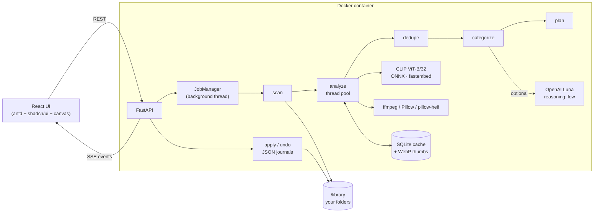

# Architecture

## Pipeline (one job)
| Step | What happens | Module |
|---|---|---|
| rules (rule strategy) | Vision AI compiles natural-language instructions into validated relative paths before any analysis. Dates are frozen at sort start. | `rules.py`, `llm.py` |
| scan | Walk the chosen folder (optionally recursively). Hidden folders, the output folder and `_Duplicates` are skipped. | `scanner.py` |
| analyze | Decode with draft-mode JPEG, EXIF orientation and date, HEIC. Video keyframes come from ffmpeg (20/50/80%). SHA-256, pHash, screenshot signal, 160 px WebP thumbnail, CLIP embedding (videos: mean of frames). Results are cached by (path, size, mtime). | `media.py`, `embedder.py`, `cache.py` |
| dedupe | Union-find over SHA-256 matches plus pHash ≤ 4 with CLIP cosine ≥ 0.90. Keeper = most pixels, then size, then oldest. | `dedupe.py` |
| categorize | Preset/custom: zero-shot `softmax(100·cos)` over averaged prompt embeddings, a screenshot rule, per-category floors, optional AI assist. Auto: KMeans + silhouette, named by Luna or the vocabulary. Date: capture date. | `classify.py`, `llm.py` |
| plan | Destination per file: `<folder>/<output>/Photos|Videos/<Category>/`; AI rules use their explicit relative paths without media prefixes | `planner.py` |
| apply / undo | Move or copy with collision-safe names, a journal written as it goes, reverse replay, and cleanup of the folders it created | `organizer.py` |

Each step emits events (`phase`, `scanned`, `file`, `progress`, `stats`, `categories`, `assign`, `done`) into an append-only log.
`GET /api/jobs/{id}/events` streams it as Server-Sent Events, and late subscribers get a replay.

## The animation
`frontend/src/anim/engine.ts` draws everything on one `<canvas>` laid over the stage:
- every `file` event adds a sprite with a pre-rendered "polaroid" tile (frame and shadow baked in, so one `drawImage` per sprite per frame);
- the pile is stored in polar coordinates and re-projected each frame, so it follows layout changes;
- `assign` events queue flights. Flights are released at `n / (60 · 5s)` per frame, so every run lasts about 5 s, and they follow an eased arc to the next slot in the target card (whose rect is read from the DOM each frame);
- `prefers-reduced-motion` makes sprites jump straight to their slots;
- themes are CSS variables; the engine re-reads them and re-renders tiles when the theme changes.

## Why these choices
- **ONNX CLIP instead of PyTorch**: CPU by default, optional CUDA runtime, a much smaller image, the model is bundled, and it works offline.
- **The LLM is optional and called rarely**: one request names every cluster; assist sends batched low-detail thumbnails. The explicit AI-rules strategy uses one compilation request plus all eligible thumbnails.
- **SSE instead of WebSockets**: the stream is one-way, and replay is trivial.
- **Plan → apply → journal**: you can trust it with your real folders.

## Culling recommendations

`picks.py` adapts weights to detected or explicitly selected photography profiles. Technical focus/clipping/noise,
face expressions, geometry and paired CLIP/SigLIP presentation prompts form absolute component scores. These are
blended with within-shoot and scene rankings. Keeper thresholds, Review stars and XMP ratings share this score.
Selection covers scenes, suppresses near-duplicates and leaves the quota unfilled when candidates are weak.
Quality cache version 3 stores per-face eye focus alongside expressions. See [research notes](culling-research.md).

## Device selection

Compose extends `docker/compose.${DEVICE}.yml` (CPU default) to choose the Docker target and optional NVIDIA
reservation. The embedder selects explicit execution providers for both text and image towers and validates CUDA
activation. Singleton identity includes model, device and cache path; cache files remain separated by model.
